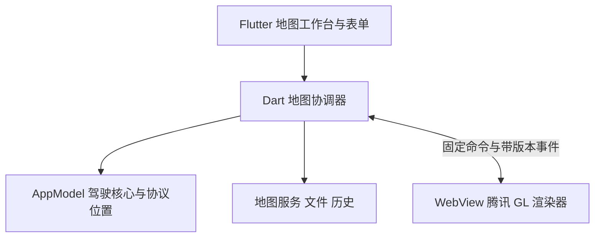

# 地图操作面板 Flutter 化方案

更新：2026-10-20。依据用户提供的两张安卓截图及当前源码。

**状态：2026-10-20 已开始实施，运行代码已接入 Flutter 操作面板与最小腾讯 GL 渲染器；下面的设计要求作为验收依据，不能视为四平台已经验收。**

本轮采用方案中的无缝贴边布局：竖屏地图与 Flutter 面板上下衔接，宽屏左右衔接。面板没有外围网页灰底，SDK 版权留在地图真实区域。跨 WebView 的连续底图浮层/模糊尚未启用，不能将当前实色 Material 面板描述为已完成液态玻璃或鸿蒙原生光感。

已接入的生产组件是 `MapWorkspaceController`、`MapControlPanel`、`editMapVehicle` 及工作台中的地图视图；JS 资源只保留 index、canvas、桥接和基础布局四个文件。搜索/联想、三模式选点、规划候选、坐标切换、速度、开始/停止、文件/统一历史、四预设/传动参数/14 类情景表单、遥测与手动控制均由 Flutter/Dart 负责。

既有 `MapSession` 仅保留供旧桥接回归源码引用，生产工作台不导入它；历史测试不能代表新面板已通过回归。当前构建/运行证据见实施记录。

## 1. 两个已确认的问题

### 图一：面板外有整片灰底，地图和面板分离

`assets/map/host.css` 通过 `#map` 的 left/bottom 偏移给面板留出真实空区；`app.css` 的 body 背景是 `#dbe5ec`。空区没有地图内容，半透明面板和外阴影叠在这片背景上，形成灰色包边与割裂感。`.map-vignette` 的整屏阴影还会进一步加深背景。

这是布局与图层关系的问题。后续优先采用连续地图底层和 Flutter 浮层，不再为圆角面板外的空白挖出整片网页背景；也不能只把灰色换成白色来掩盖空区。

### 图二：速度与坐标系没有对齐

两列虽然都在 `.field-row` 中，但左列的 `.speed-field-heading` 额外包含驾驶设置按钮；触控适配把按钮增大到 40–44px，撑高左列标题区，右列仍只有一行标签。两个输入控件因此处于不同的纵向位置。

后续把驾驶设置移出速度字段的标题行，让两个字段使用同一套标签、输入框高度、内边距与基线。空间不足或字体放大后自动改成单列。

## 2. 确定采用的方向

**操作界面由 Flutter 控件绘制；腾讯 GL WebView 负责地图画面、点线图层和地理交互。** 此处的 Flutter 原生面板指 Flutter Widget，不表示为四个平台分别编写一套系统表单。

| 区域 | 后续实现 |
|---|---|
| 搜索框、联想、搜索结果、搜索历史 | Flutter；直接调用现有 Dart 地图服务/历史存储 |
| 导航/绘制/单点模式、起终点、候选路线 | Flutter 控件与 Dart 状态 |
| 模拟速度、坐标系、驾驶设置 | Flutter 表单；共用应用主题与输入规范 |
| 文件、轨迹库、重命名、删除与确认 | Flutter；复用四平台文件接口与统一历史 |
| 开始/停止、准备状态、进度、驾驶遥测、手动控制 | Flutter；直接连接现有 AppModel/驾驶核心 |
| 地图设置、2D/3D、定位、跟随、加载与重试提示 | Flutter 控件；向渲染器发送固定命令 |
| 底图、标记、选点反馈、路线、车辆位置/航向 | 保留腾讯 JavaScript API GL |
| 腾讯版权与审图号、SDK 必需归属 | 保留 SDK 正式显示方式，不能被面板遮挡或替换成伪造标识 |

最终移除 Web 页中的操作面板、车辆表单及重复业务状态；不在 Flutter 上套一层按钮去点击隐藏的 HTML 控件。



协调器持有选点模式、原始路线、用户坐标系、候选选择和跟随状态。JS 接收用于显示的坐标/标记/路线，返回地图点击等事件；业务逻辑与状态唯一来源在 Dart。坐标显示转换不能改变路线文件及 JT808 汇报值。

## 3. 视觉与布局

### 连续底图与一体化面板

- 首选 Flutter `Stack` 中连续铺底的地图视图，上方叠加局部裁剪的操作面板、地图工具与驾驶状态；不再显示网页 body 的灰色外壳。
- 手机面板顶部圆角 24dp，轻阴影和细描边；减少多层大圆角卡片、嵌套灰底和空白，让搜索、路线编辑、模拟参数形成连续内容层级。
- 宽屏侧面板宽度约 320–400dp，与其他应用页面共用文字、图标、色彩和焦点规范；不把手机面板按物理分辨率整体放大。
- 面板外的透明区域仍可拖图/缩放；点按钮、拖面板和滚表单不能同时触发地图手势。
- 系统安全区只处理一次。顶部工具区与底部手势区跟随同一工作台背景，不额外留出灰色条带。

### 速度与坐标系

采用以下内容结构：

```text
模拟参数                         驾驶设置

模拟速度                         坐标系
[ 60                  km/h ]    [ GCJ-02          v ]

打开路线       保存路线       轨迹库
```

- “驾驶设置”属于独立工具行，不占用速度字段标签的高度。
- 速度和坐标系使用同一输入装饰、标签行高度和最小 48dp 控件高度；两列的顶部、底部、内容基线一致。
- 使用 `LayoutBuilder` 按面板实际内容宽度排布：每列以至少约 160dp 为起点，两列加间距放得下才并排；字体缩放或长标签需要更多宽度时改单列，不强塞两列。
- 手机数值键盘只影响正在编辑的区域。速度输入、校验和提交状态可见，不能因键盘出现而静默改变模拟状态。
- 固定速度和真实驾驶两种模式保持清晰；真实驾驶启用时展示相应速度摘要，避免看起来仍可编辑的无效输入框。

### 响应式交互

| 空间 | 后续方案 |
|---|---|
| 手机竖屏、窄分屏 | Flutter 可拖拽底部面板，收起/常用/展开三档；常用档初始约 45%，不是固定占用 55% 的网页卡片 |
| 小高度横屏 | 紧凑侧面板，内容滚动；开始/停止独立于内容滚动区 |
| 平板/桌面宽窗口 | 侧面板与浮动工具，合理限制内容宽度；鼠标、触控和键盘均可操作 |
| 软键盘 | 以 `MediaQuery.viewInsets` 和实际约束调整，滚动活动字段到可见处；停止运行的入口仍可达，必要时收敛为一个固定停止按钮 |
| 折叠/连续调整窗口 | 按可用空间重排；保留地图实例、选点、未提交文本和模拟状态，不因断点切换重新初始化地图 |

拖拽面板可基于 Flutter [DraggableScrollableSheet](https://api.flutter.dev/flutter/widgets/DraggableScrollableSheet-class.html)，需使用组件提供的滚动控制器处理拖拽与滚动接力。桌面提供明确的展开/收起入口，不依赖手机手势。

## 4. 地图避让、版权与材质的实施边界

### 视野避让与真实容器分开

- 根据 Flutter 实际面板尺寸、安全区和键盘位置生成 `MapViewportInsets`，传给地图渲染器。
- 路线拟合使用腾讯 `fitBounds` 的四方向 padding；车辆跟随还需独立处理视野中心偏移，不能只在首次规划时避让。
- 面板拖拽时合并几何更新，避免逐像素 JS 往返和连续全路线重拟合；用户手动拖图后保留其跟随意图。
- **相机 padding 不会自动移动 SDK 版权标识。** 必须单独确认 SDK 支持的归属布局方式，并让版权/审图号在每个面板档位保持可见。不能隐藏 SDK 标识、覆盖标识或依赖未公开的内部 DOM 修改。
- 若某平台无法同时满足浮层合成和 SDK 归属布局，使用地图区域与贴边 Flutter 面板无缝衔接的布局：面板外壳铺满对应区域、共用 Surface、没有灰色包边和重复间隙。该回退仍使用同一套 Flutter 控件和 Dart 状态。

四方向边距接口依据 [腾讯 Map / FitBoundsOptions 官方文档](https://lbs.qq.com/webApi/javascriptGL/glDoc/docIndexMap)。SDK 归属布局仍为原型验证事项，不宣称已具备统一可调接口。

### 四平台合成与玻璃

| 平台 | 已查明的基础 | 后续必须验证 |
|---|---|---|
| Windows/Linux | 当前 `webview_cef 0.6.2` Dart 实现使用 Flutter `Texture` | 浮层遮挡、焦点/输入法、重绘同步；Linux 还需真实构建环境 |
| Android | 当前 CPF WebView Android 实现使用 `PlatformViewLink`/`AndroidViewSurface` | 面板叠层、点击阻隔、拖拽竞争、键盘及合成性能 |
| HarmonyOS | 沿用当前 CPF WebView 与原生材质适配方向 | ArkWeb 与 Flutter 层叠、原生导航/材质层级及 API 17/26 回退 |

Flutter 控件能统一布局、字体和动效；这不代表跨 WebView 的背景模糊在所有平台自动成立。先证明基本叠层和输入可用，再启用面板局部 `BackdropFilter`。Android 平台视图存在不同合成方式与性能代价，依据 [Flutter Platform Views 文档](https://docs.flutter.dev/platform-integration/android/platform-views)。

液态玻璃集中在面板边缘、工具胶囊和轻量驾驶摘要，表单内部以可读性为先；模糊不可用或性能不足时使用同主题的半透明/实色材质。不得用实时截图替代可交互的地图来伪装模糊效果。

HarmonyOS 原生沉浸光感继续单独适配：原生导航/页签与材质能力桥接，API 26 启用能力、API 17 回退；Flutter 面板的模糊不等同于鸿蒙原生光感已经完成。系统/应用减少动画设置同时约束抽屉、弹窗及地图视角过渡。

## 5. 状态与桥接改造

已拆分 `MapWorkspaceController` 和 `MapControlPanel`，速度/坐标系与驾驶状态目前分别在面板内部构建；后续可继续提取独立 Widget。工作台使用稳定 GlobalKey 保留旋转/断点变化时的地图与编辑状态。

1. 从现有 `MapSession` 提取服务、历史、文件与驾驶操作，交给 Dart 协调器；Flutter 事件直接调用这些方法。
2. 新增最小地图渲染入口，固定命令只负责相机、标记、路线、车辆、外观和避让；固定事件包括 ready、选点、拖图/视野变化与脱敏错误。
3. 保留来源检查、随机 token、消息大小边界、页面代次及请求取消；搜索联想防抖、输入法组合期抑制和过期响应过滤转移到 Dart。
4. 地图重载后重放当前渲染快照，不能重新启动模拟、重复发送文件/历史写操作或恢复旧页面的过期请求。
5. 原始坐标/路线、Dart 驾驶核心、统一历史格式与 `docs/KEY.txt` 构建注入方案继续使用；面板不增加 Key 输入或输出入口。

## 6. 实施顺序与验收

| 阶段 | 交付内容 | 通过条件 |
|---|---|---|
| P0 | 把两张截图的问题列为下一版试用包必须修复项；确定面板尺寸和字段规范 | 灰色外壳、字段错位不能保留为预期设计 |
| P1 | 最小 Flutter 面板与腾讯 GL 渲染器原型；先 Android、Windows，再补其余平台 | 连续背景、手势阻隔、键盘、归属显示、合成可行；仍保留实色回退 |
| P2 | 搜索、模式、起终点、候选、速度/坐标系、开始/停止、文件/历史迁移 | 原功能完整；Dart 为唯一业务状态；重载/方向变化不丢数据 |
| P3 | 车辆设置、14 类事件表单、驾驶摘要与手动控制迁移 | 长表单可达、实时更新不打断编辑、不重启地图；移除旧 HTML 操作界面 |
| P4 | 四平台设备矩阵、无障碍与帧耗时/输入延迟测量，鸿蒙原生材质联调 | 逐平台提供证据，不用一次安卓截图替代四平台验收 |

验收沿用 `map-responsive-design.md` 的尺寸矩阵，额外要求：

- 灰底/包边在面板收起、常用、展开、旋转、键盘开关、主题切换时都不出现。
- 默认字体时，速度和坐标系并排则上下对齐；320 宽、大字体 1.5/2 倍时可改单列但不得错位、裁切或遮住单位。
- 连续拖拽面板、拖图和模拟运行时，操作响应和状态保持一致；每个平台单独记录真实 GPU 表现。
- SDK 版权/审图号完整可见；停止按钮在运行时、输入法开启和低高度情况下仍可达。
- 下一次运行包应标注是否已采用 Flutter 面板，不能以文档更新或编译成功声称界面迁移完成。

## 实施记录（2026-10-20）

- 已接入上述 Flutter 生产组件，操作表单、搜索、历史、车辆设置及业务协调移至 Dart；网页只保留地图渲染及受限事件桥。实际交互仍需逐功能、逐平台扩大验收。
- Dart 静态分析无问题，canvas.js/host.js、PowerShell/Bash 构建脚本语法检查通过。本轮没有新增或运行自动化测试。
- 最终 Android、Windows、HarmonyOS Debug 构建成功，日志在仓库 `bin/Debug/flutter-native-map-{android|windows|ohos}.log`，产物在 `bin/Debug/Flutter/{平台}/source/build/`；HAP 未签名，Linux 未构建。
- API 37 可见安卓模拟器已更新最终 APK。真实底图、SDK 归属及 Flutter 面板同时可见，外围网页灰底消失；速度和坐标控件的实际屏幕上下边界均为 1987–2145 px。驾驶设置为 Flutter 原生长表单弹窗，保存动作固定。
- 当前截图位于仓库 `bin/Debug/flutter-ui/android-native-map.png`、`android-native-fields.png`、`android-native-vehicle.png`。运行截图仅代表本次模拟器观察，不能代替四平台设备矩阵或真实 GPU 性能证据。
- 补充图形诊断：SwiftShader 软件 GPU 下，腾讯折线图层已有点且可见标志为真，但截图没有线条；同一最终 APK 在 `-gpu host`、NVIDIA RTX 2050 后端中正常显示蓝色路线（`bin/Debug/flutter-ui/android-native-host-line.png`）。该复现说明当前虚拟图形后端会影响显示，不能据此声称所有 GPU 或真机均已通过。
- 主机 GPU 实例随后连接中断并退出；日志含 external memory / ColorBufferGl 导入错误及 Qt 窗口更新错误，不能据此断言退出的唯一原因，也不能把本次主机 GPU 试用作为稳定性通过。日志在仓库 `bin/Debug/android-native-host-emulator{,-error}.log`，继续试用前重新查询设备状态。
- 本机短时操作已走通绘制、开始模拟、车辆跟随及停止，未见 Flutter 布局异常；这不是终端服务联调或长稳验收。
- APK/HAP 及 Windows Flutter 资源只保留四个地图文件。三平台构建副本共 27 项运行源码/资源哈希比较一致；公开源码、构建日志和已检查产物未发现本机 Key 明文，原始 Key 文件未打包，生成输入已清理。
- 连续地图下的玻璃浮层、鸿蒙原生沉浸光感、Linux 构建、完整字体/键盘矩阵及真实 GPU 性能仍未完成。当前交付采用无缝贴边实色材质。
